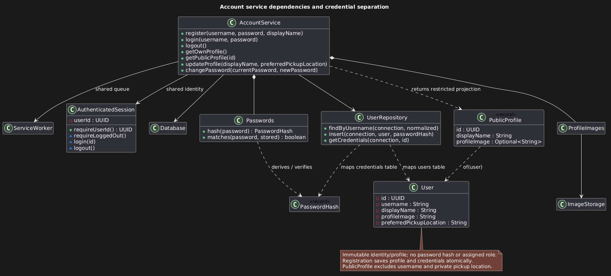
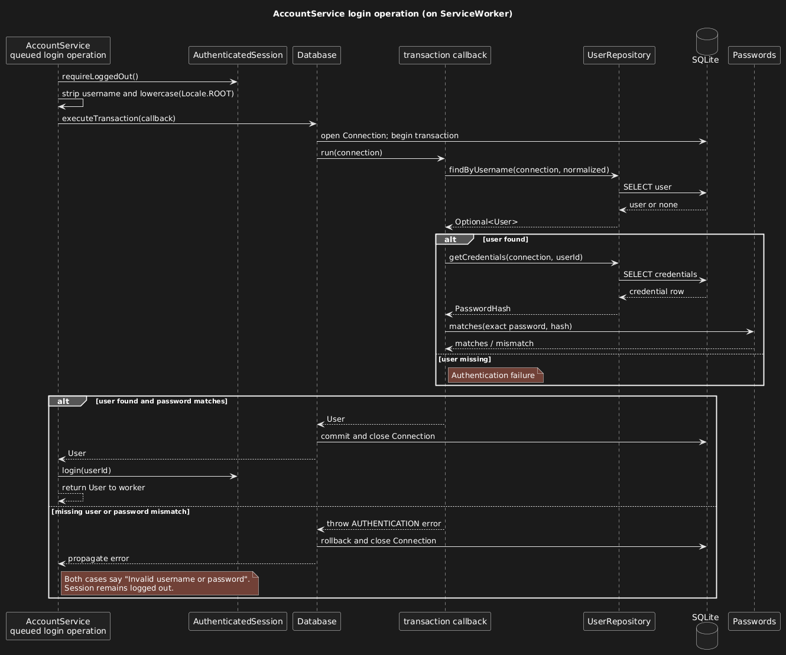

## Account Service and PostgreSQL Persistence

### Runtime lifecycle and data directory

`ApplicationRuntime.open` owns the image-directory lock, schema validation, image
recovery, shared service worker and services. Close it to drain queued work before
releasing the lock. `Main.init` opens the runtime off the JavaFX thread;
`Main.stop` starts asynchronous shutdown. Initialization failures show an error
instead of resetting storage. See [runtime initialization and shutdown](ArchitectureOverview.html#runtime-initialization-and-shutdown)
for the database/description-owner overloads.

The directory selects managed images and locking only; it does not select the
PostgreSQL database. It contains `application.lock`, `images/profiles/` and
`images/listings/`. Legacy `marketplace.db` files are left untouched. The directory
defaults to `${user.home}/.hotshop`; override it before `-jar`, for example:

```powershell
java "-Dhotshop.dataDir=C:\HotShop-test-data" -jar release/HotShop.jar
```

The current Gradle `run` task does not forward this system property to its
application JVM. The default Windows folder is normally `%USERPROFILE%\.hotshop`.
Deleting the directory does not reset PostgreSQL records and can remove images
still referenced by those records. Use a separate disposable database and image
directory for experiments.

### PostgreSQL storage and transactions

PostgreSQL is used in development, production and tests, with no SQLite runtime
dependency. Fresh installations start empty; SQLite records are not imported.
Images remain local; Supabase Storage and hosted deployment are separate integration
work. Database tests do not establish two-browser isolation, JPro directory-lock
behavior or shared-storage cleanup safety.

`DatabaseConfig` reads server environment settings or accepts explicit fixture
configuration. It supplies credentials as separate JDBC properties, redacts
configuration diagnostics and uses a 10-second connect timeout and 30-second socket
timeout. See [operator setup](#postgresql-operator-setup) for connection settings.

`Database.executeTransaction` opens a connection at serializable isolation, commits
or rolls back the callback, and closes the connection. Pass that same connection
to every repository participating in a business operation. `UserRepository` maps
profiles and separate `PasswordHash` records; it does not authorize callers.
SQLSTATE `40001` and `40P01` return safe retry guidance without automatically
replaying the callback. A username-specific unique violation returns
`Username is unavailable`; other constraint failures remain storage errors.

### Schema and provisioning

The initial PostgreSQL schema is
`src/main/resources/db/postgresql/001_initial.sql`. It includes accounts and
credentials, listings/images, offers, sales and cancellations, meetup slots/bookings/
rescheduling, conversations/messages and durable image cleanup. Constraints preserve
one pending offer per buyer/listing, one active sale per listing, one pending
cancellation per sale, one scheduled meetup per sale and one pending move proposal
per meetup. Conversations are unique per listing/buyer, and messages per
conversation/sequence number.

Proposal and cancellation histories use an internal `BIGINT` identity
`history_order` to break ties between equal application timestamps. This replaces
SQLite row insertion ordering without generating domain event times or sorting
random UUIDs. `Transaction` restores its internal `lastEventAt` from persisted times.

Provisioning is separate from application startup. `Database.migrate` takes a
transaction advisory lock and applies all pending migrations together with their
version records atomically. Failure rolls back the batch; repeated provisioning
preserves records. A schema newer than the application is rejected. Startup only
validates the installed schema version with read-only queries; missing, older or
newer schemas require compatible provisioning. It never migrates, seeds or resets
records during runtime opening.

#### Adding a migration

1. Add `src/main/resources/db/postgresql/NNN_description.sql`.
2. Append its resource path to `Database.POSTGRES_MIGRATIONS`. Its one-based list
   position supplies the version; never edit or reorder a released migration.
3. Add disposable PostgreSQL tests for upgrade preservation, failed-batch rollback
   and schema-version validation. Provision through the separate schema command.

If two branches add the same version, renumber the later addition. Statements are
split on `;`, so migration scripts must not contain function bodies or embedded
semicolons that require a SQL parser.

`DatabaseTest` supplies independent migration resources from
`src/test/resources/db/test-migration/` through a package-private constructor.
See [Development Workflow](DevelopmentWorkflow.html#isolated-database-tests) for
fixture isolation and verification commands.

### PostgreSQL operator setup

Set `HOTSHOP_DB_URL` to a credential-free `jdbc:postgresql://` URL. Supply
`HOTSHOP_DB_USER` and `HOTSHOP_DB_PASSWORD` as separate server environment values;
never put credentials in the URL or print environment values. Use a distinct
database per environment.

Remote URLs require canonical `sslmode=verify-full` and appropriate certificate
trust; uppercase or encoded spellings of the `sslmode` option are rejected.
For a custom certificate file, pass its local path as the `sslrootcert` URL
parameter. Local Docker PostgreSQL can use a local connection. For a dedicated
JDBC-only Supabase project, disabling the unused Data API prevents a separate
access route; leaving it enabled requires appropriate grants/RLS for exposed tables.

Run `.\gradlew.bat migrateDatabase` on Windows or `./gradlew migrateDatabase` on
macOS/Linux. This creates/upgrades the schema without starting the UI. Use operator
permissions for schema changes. Runtime credentials need `SELECT`, `INSERT`,
`UPDATE` and `DELETE` on marketplace tables and `SELECT` on `schema_migrations`,
without `CREATE`/`ALTER` permissions. Restart preserves records; provisioning neither
imports SQLite data nor seeds/resets the database.

Failed provisioning exits nonzero with `Database provisioning failed`; driver
exception text and credentials are omitted. Check server settings, connectivity,
certificate trust and provisioning permissions outside application logs.
For a local container example, see [Local PostgreSQL development](DevelopmentWorkflow.html#local-postgresql-development).
The [technical design](https://github.com/CS3227-2610-MP3-HotShop/CS3227-2610-MP3/blob/main/workflow/TECHNICAL-SPEC.md),
[execution plan](https://github.com/CS3227-2610-MP3-HotShop/CS3227-2610-MP3/blob/main/workflow/PLAN.md) and
[feature summary](https://github.com/CS3227-2610-MP3-HotShop/CS3227-2610-MP3/blob/main/logs/2026-10-19-feature-pg-conversion-sdd-summary.md)
provide design and verification context.

### Account operations and authentication

#### Service API and error handling

AccountService returns `CompletableFuture` results. Its public operations are
`register`, `login`, `logout`, `getCurrentUserId`, `getOwnProfile`, `getPublicProfile`,
`updateProfile`, `changePassword`, `replaceProfileImage`, and `removeProfileImage`.
`recoverImages` is a lifecycle maintenance operation. Access the service through
`ApplicationRuntime.getAccounts()`. `ServiceException.getCode()` distinguishes
validation, authentication, session, duplicate username, not-found, storage,
permission, and invalid-state failures for every service; a joined future wraps
the exception in `CompletionException`.

#### Shared session and worker integration

Future services must share the same `ServiceWorker`, `AuthenticatedSession`, and
`Database` when wired into ApplicationRuntime. Resolve acting identity inside the
queued operation, not when a controller submits it. The session contains only
the UUID; profile reads use the latest persisted record. PublicProfile includes
only ID, display name, and optional image filename. Private pickup preferences
and credential records must never be passed to another user's profile screen.
Callbacks may execute on the service worker; marshal UI updates using
`Platform.runLater`. Do not block that worker by joining another service call or
closing the runtime from a completion callback. Closing belongs to the lifecycle
owner. Cancelling a returned future does not cancel an already queued mutation.

[](../diagrams/accounts_uml.png)

#### Password storage and login

Passwords use PBKDF2-HMAC-SHA256, a fresh 16-byte salt, 600,000 iterations, and a
256-bit derived key, with algorithm/work-factor metadata persisted separately.
Password strings are not normalized or stripped. No password/hash is returned
through a profile. Authentication is implemented by the application's account
service using credentials persisted in PostgreSQL; PostgreSQL is not a separate
end-user authentication service.

The login sequence shows credential verification inside the database transaction
and session establishment only after successful verification.

[](../diagrams/login_uml.png)

### Image storage and recovery

ImageStorage accepts per-feature limits and validates actual JPEG/PNG contents,
dimensions, and bounded bytes before writing a generated filename. `ManagedImages`
owns one image namespace (a folder, its limits, a "still referenced" query, and
its rows in the durable `image_cleanup` queue). It imports files, queues retired
files inside the caller's transaction, and recovers orphans. `ProfileImages` and
`ListingService` each configure one (`profiles` and `listings`), so recovery in
one namespace never processes or deletes the other's files. Cleanup rechecks
database references and retries failed removals at startup. A new image feature
should add a namespace to the `image_cleanup` CHECK constraint in a migration
and construct its own `ManagedImages`. SQL fixtures/triggers
in tests inject persistence failures at the external database boundary; assertions
check service-visible results and managed-file lifecycle.
