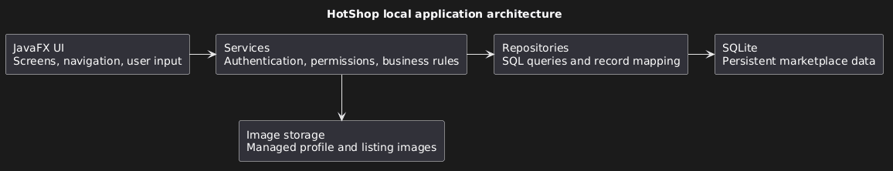

## Structure

### Repository layout

- `src/main/java/hotshop/Launcher.java`: executable JAR entry point.
- `src/main/java/hotshop/Main.java`: JavaFX lifecycle and marketplace startup.
- `src/main/java/hotshop/ui/`: application shell, feature screens, and shared presentation controls.
- `src/main/resources/hotshop/`: application stylesheet.
- `src/main/java/hotshop/model/`: shared buyer/seller domain models and supporting types.
- `src/test/java/hotshop/`: JUnit 5 model behaviour and boundary tests.
- `config/checkstyle/checkstyle.xml`: executable style checks.
- `docs/`: guides and GitHub Pages source.
- `logs/`: agent interaction records.
- `release/HotShop.jar`: generated distribution, ignored by Git.

### Build structure and implementation scope

This is a single-project, non-modular build. Launcher is separate from the
Application subclass so the bundled JAR can launch JavaFX from the classpath.
The shared model layer, AccountService, ListingService, OfferService,
TransactionService, MeetupService, and ChatService are implemented, including
PostgreSQL persistence, authentication, profile and listing images, buyer listing
search, offers, sale completion and cancellation, sales and purchase history,
meetup slots and bookings, conversations and messages, the sales dashboard
summary, and lifecycle initialization. The account, profile, listing/search,
offer, sale, seller-dashboard, conversation, and meetup screens now call those
services. Wishlists remain deferred; their UI entry points are disabled.
Notifications were dropped from this release on 2026-09-25, so there is no
NotificationService and no Notifications sidebar entry. Users learn about
events from next steps, list ordering, pending-offer counts, and conversation
unread counts instead.

## Architecture overview

### Application entry points

HotShop runs locally in one process. `Main.init` opens `ApplicationRuntime` before
`Main.start` creates `MarketplaceUi`. Feature page classes build JavaFX controls
and handle their actions; there is no separate controller package in the current
implementation.

The diagram above is historical: its SQLite node is replaced by PostgreSQL/JDBC.
Production profile and listing photos use private Supabase Storage buckets, while
the local runtime directory holds the process lock.

### Layers and responsibilities

| Layer | Current components | Responsibility |
| --- | --- | --- |
| UI | `MarketplaceUi`, feature pages, `UiPage` | Navigation, forms, presentation validation, and asynchronous feedback. |
| Service | `AccountService`, `ListingService`, `OfferService`, `TransactionService`, `MeetupService`, `ChatService` | Authentication, permissions, business rules, and atomic operations. |
| Repository | `UserRepository`, `ListingRepository`, `OfferRepository`, `TransactionRepository`, `MeetupRepository`, `ChatRepository` | Execute SQL using a supplied connection and map records to models. |
| Database | `Database`, PostgreSQL JDBC, `DatabaseConfig` | Serializable transactions, explicit provisioning and schema validation. |

Services also use Java models to enforce domain invariants. Profile and listing
image services coordinate private object uploads, authorized reads and cleanup with
saved database references. UI image resolution goes through the runtime rather than
repositories; production startup requires both configured Storage buckets.

For browser image selection, profile and listing pages bind a JPro uploader to each
trigger before the page is rendered and explicitly enable click selection. The page
stays interactive while the browser chooser is open; selecting a file starts busy
feedback and upload. Since JPro exposes no chooser-cancel callback, cancellation
leaves the trigger available for another attempt. Page departure clears the pending
selection, and any late staged file is released before application work can start.
The native JavaFX path continues to use `FileChooser` and validates the selected
image before accepting it.

### Runtime initialization and shutdown

`Main` owns a process-local directory-lock registry. JPro browser instances that
resolve to the same normalized data directory receive separate runtime leases over
one operating-system lock. Each runtime still creates its own repositories,
services, worker and authenticated session. The physical lock remains held until
the last lease has drained and closed. Direct `ApplicationRuntime.open` calls
retain exclusive directory locking, and a separate owner or process is still
rejected while the lock is held. Runtime initialization validates the provisioned
database and Storage configuration, creates separate profile/listing image stores,
and constructs the repositories
and six services. All services share one `Database`, `ServiceWorker`, and
`AuthenticatedSession`; time-dependent services share the supplied clock. Startup
recovers managed images before returning. Closing the runtime drains accepted
worker operations, closes Storage resources and releases its lease. The session is
in memory and starts logged out for each browser instance.

The production overload taking a description owner supplies environment-derived
database and private Storage configuration. The explicit database-configuration
overloads can select local image fixtures; the overload also taking a Storage
configuration uses the remote object store. Without an explicit description owner,
those overloads use the offline seller-generation owner. The two-argument overload
supplies database defaults, and the one-argument overload also supplies the system
clock. Runtime directories select the process lock; PostgreSQL and Storage settings
are supplied separately.

