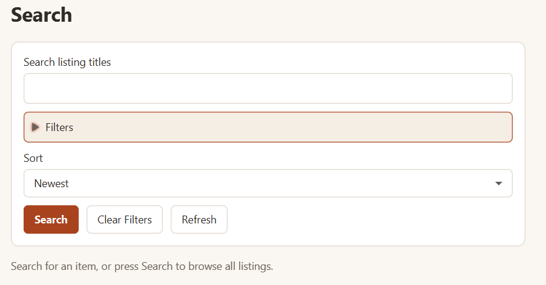

## Search and listings

### Searching and filtering

Search starts with guidance and no results. Enter a title query and press Enter
or **Search**. An empty query searches all eligible listings from other sellers.
Open **Filters** for category, conditions, and minimum/maximum SGD price.
**All categories** means there is no category restriction; selecting no conditions
includes all conditions. **Clear Filters** restores these defaults and clears both
price fields. Query and filter changes take effect only on submission. If a price
is invalid when you submit, **Filters** opens automatically to show the error.

With AI search configured, enter a description in the same query field and choose
**AI Search** to request suggested filters. Review the title, category, conditions,
price limits, and sort order in the preview, then choose **Apply filters** to replace
the current filter draft and run the ordinary search. **Dismiss** closes the preview
without changing the search. Editing a query or filter, submitting a manual search,
or leaving Search clears any pending suggestion. AI search accepts 1 to 1,000
nonblank Unicode characters. When it is unavailable or a request fails, the screen
shows a safe status message and manual search remains available.

### Sorting and refreshing results

The sort choices are **Newest**, **Price low to high**, and **Price high to low**.
Sorting reorders the last submitted results immediately. The count above the
results shows "1 listing" or "n listings", including "0 listings" for no matches.
**Clear Filters** does not submit; **Refresh**
reruns the last submitted search. Back navigation retains draft fields and the
submitted search, sorting, and scroll position. A new login resets search.

### Viewing results and listing details

For example, search for `desk`, choose Furniture, and set a maximum price of
`50.00`. Matching listing cards show a photo or placeholder, title, asking price,
and condition. Open a card to see all photos, the description, status, category,
condition, pickup location, and seller profile link. No matches and failed loads
have different messages; a failed load offers **Retry**.

Long card titles end with an ellipsis; open the card to read the full title.
Photos fit completely inside their frames without cropping.

### Creating a listing and adding photos

Under Selling, **My Listings** shows your listings, status, and pending-offer counts;
condition is available on the detail page instead of these owner cards.
Choose **Create Listing** and fill in **Title**, **Description**, **Asking price
(SGD)**, **Category**, **Condition**, and **Listing pickup location**. Optionally
use **Add Photo**; the file chooser offers `.jpg`, `.jpeg`, and `.png` files.
Choose **Save Listing** to save and open the listing, or **Cancel** to go back
(you will be asked to discard any unsaved changes).
Photo previews have **Move Up**, **Move Down**, and **Remove** controls. New listings
prefill your preferred pickup location, which you can change for that listing.
Photos are validated before being added and revalidated when saved; the app
does not automatically crop or resize images.

### Generating a listing description

In **Create Listing**, enter a **Title** (1–120 Unicode code points after trimming) and
choose a **Condition**, then select **Generate Description**. For example,
`Wooden chair` and `Good` are enough; price, category, photos and pickup location
are not needed for generation. Your title and condition are sent to an external
LLM. Your existing description and other listing fields are not sent.

A successful result immediately replaces the entire Description field without
confirmation. Generated text has at most 100 words; review its accuracy and edit
it as needed. The usual target is 50–70 words; shorter valid results are allowed.
Check that it describes the item rather than repeating requests
from the title or asking for more information. It remains unsaved until you fill in the required listing fields
and choose **Save Listing**. Generation is available only when creating a listing.
The 100-word generation limit does not change the usual manual description/save limits.

While generating, progress appears and Generate is disabled. You can still edit,
save manually or leave using the usual unsaved-changes confirmation. Editing the
title, condition or description while generation is pending makes that result
stale, even if you change the value back. Your draft is kept and you can request
generation again after the earlier attempt finishes. Leaving, logging out or
closing the window also prevents its result from updating that form. Cancelling
the discard/close confirmation keeps the form usable.

Failures show feedback beside Generate and preserve your draft. You can retry
deliberately or write your own description; missing provider settings do not
prevent manual saving. One request may run per account, with limits of five
attempts per rolling minute and thirty per rolling hour. A local rate-limit
message gives a retry delay. Dispatched provider failures and timeouts count toward
these limits; invalid local inputs do not. There are no automatic retries. The
transport attempt has a 45-second deadline, including waiting for dispatch and
reading/validating the response. Leaving the form does not immediately free an
account's active request. Limits reset when the server process restarts.

The app does not execute returned commands or open returned links. Generated text
can still be inaccurate or follow unwanted instructions; review every result.
Remote provider tool use and independent concurrent hosted-user sessions have not
been verified. These limits do not prevent manual listing creation.

### Editing, archiving, and deleting listings

Open one of your listings for **Edit Listing**, **Archive Listing**, **Delete
Listing**, and Incoming Offers. Actions unavailable in the listing's state are
disabled with an explanation. Saving actual changes with pending offers asks for
confirmation because those offers will be rejected. Archival and permanent deletion
also explain their consequences before proceeding.
